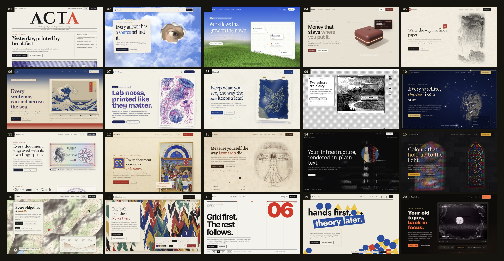

<div align="center">

# ALSKai UI

**20 landing pages built from public-domain masterpieces.**<br>
**20 个网站，素材全是几百年前的名画。**

Fan Kuan · Hokusai · Leonardo · Vermeer · Haeckel · Hevelius · Méliès

<a href="LICENSE"></a>


Made with Claude Code · by [ALSKai](https://x.com/ALSK_ai)

[English](#english) · [中文](#中文)

</div>



## English

Each site is **one HTML file** with inline CSS and JS, one signature interaction, and a bilingual (English / Chinese) toggle. No framework, no build step. Every image is public domain or CC0 from museum collections; seven of the sites use no images at all and draw everything in code.

### The 20 sites

| # | Site | Style | Signature interaction |
|:-:|---|---|---|
| 01 | [Acta](sites/01-halftone/) | Two-ink halftone | Newspaper front page printed in rotated dot screens, with a printer's loupe |
| 02 | [Cloudrift](sites/02-collage/) | Torn-sky collage | Scroll tears the sky open to reveal Vermeer behind it |
| 03 | [Tend](sites/03-meadow/) | WebGL2 meadow | 146,000 hand-written grass blades part around your cursor |
| 04 | [Ballast](sites/04-object/) | Raymarched object | A hardware key rendered live in SDF; hold it to sign a payment |
| 05 | [Inkstone](sites/05-ink/) | Ink & handscroll | Fan Kuan's mountain bleeds into paper; a Qing handscroll unrolls as you scroll |
| 06 | [Nami](sites/06-ukiyoe/) | Woodblock print | The Great Wave printed live from five colour blocks, slipping out of register |
| 07 | [Specimen](sites/07-riso/) | Risograph | Haeckel's jellyfish on two fluorescent drums; drag to misregister |
| 08 | [Pressed](sites/08-cyanotype/) | Cyanotype | Your cursor is the sun; wherever it lingers, the print exposes |
| 09 | [Speck](sites/09-onebit/) | 1-bit dithering | Drag a lens window over Ansel Adams and re-dither it four ways |
| 10 | [Firmament](sites/10-celestial/) | Baroque star atlas | 1,010 real stars; Hevelius' 1690 Orion fades in over the real Orion |
| 11 | [Tessera](sites/11-guilloche/) | Security print | Live guilloché rosettes, a UV lamp, microtext under the loupe |
| 12 | [Rubric](sites/12-manuscript/) | Illuminated manuscript | WebGL gold leaf catches the light; a page is written in ink, red, then gold |
| 13 | [Mensura](sites/13-codex/) | Leonardo's notebook | Drag your height and the Vitruvian Man re-measures you by his ratios |
| 14 | [Glyph](sites/14-ascii/) | Live ASCII | Saturn V in characters, decoding into Earthrise as you scroll |
| 15 | [Vitrail](sites/15-glass/) | Stained glass shader | A Gothic lancet whose coloured light falls where you point |
| 16 | [Saddle](sites/16-contour/) | Live contours | Sculpt terrain with your cursor; drag a route for its cross-section |
| 17 | [Ebb & Comb](sites/17-marble/) | Mathematical marbling | Drop ink, rake the bath, pull the paper |
| 18 | [Raster](sites/18-swiss/) | Swiss grid | A real grid: change the columns and every block reflows |
| 19 | [Vorkurs](sites/19-bauhaus/) | Bauhaus physics | Primary shapes fall and stack on an inline physics engine; throw them |
| 20 | [Rewind](sites/20-vhs/) | VHS / CRT | Méliès' moon on worn tape; your cursor is the tracking knob |

### Run locally

```bash
git clone https://github.com/Albert-Lsk/alskai-ui.git
cd alskai-ui
python3 -m http.server 8000
# open http://localhost:8000
```

A local server is needed (not `file://`), because several sites read image pixels in canvas. Add `?lang=zh` or `?lang=en` to any URL to pick a language.

### How it was made

The whole project was built in [Claude Code](https://claude.com/claude-code) in one long session, starting from a post by [@uisabor](https://x.com/uisabor) asking whether a model could make landing pages like these.

1. **Find art.** Search the Wikimedia Commons API, keep only public-domain and CC0 files, and record their licences.
2. **Process it.** Python scripts (`sites/*/tools_*.py`) cut out statues by luminance, stitch handscroll segments, separate prints into colour blocks or Risograph drums.
3. **One technique per site.** Each page bets on a single interaction and does it properly.
4. **Look, then fix.** After every change the page is opened in a real browser and screenshotted at 1440 px and 390 px, in both languages. Most bugs were only visible this way: a CSS `position: sticky` silently breaking a blend mode, a decorative CJK font drawing a common character wrong, Chinese text getting a fake italic.

Four Claude sub-agents built sites in parallel; each site took 8–33 minutes. The human decisions were the brief, the design constraints (no cloning, bilingual), the name and the licence.

### Known limits

- Much of the beauty comes from the source art.
- The WebGL sites (03, 04, 12, 15, 17, 20) are GPU-heavy; low-end laptops may drop frames.
- Touch interactions were tested in device emulation, not on real phones.

## 中文

每个站只有**一个 HTML 文件**，CSS 和 JS 都写在里面，主打一个招牌交互，中英双语可切换。不用框架，不用构建。图片全部来自博物馆馆藏的公有领域或 CC0 作品；其中 7 个站一张图都没用，全靠代码画。

### 20 个站

| # | 站 | 风格 | 招牌交互 |
|:-:|---|---|---|
| 01 | [Acta 公报](sites/01-halftone/) | 双色网点印刷 | 报纸头版用两色网点印出来，放大镜能看到每个网点 |
| 02 | [Cloudrift 云隙](sites/02-collage/) | 撕纸拼贴 | 往下滚，云层被撕开，露出背后的维米尔 |
| 03 | [Tend](sites/03-meadow/) | WebGL2 草地 | 手写 WebGL2，14.6 万根草，鼠标划过会被吹开 |
| 04 | [Ballast](sites/04-object/) | 光线步进实物 | SDF 实时渲染的硬件密钥，按住它签一笔付款 |
| 05 | [Inkstone 砚](sites/05-ink/) | 水墨手卷 | 范宽的山以墨晕显影，往下滚，清代手卷一臂一臂展开 |
| 06 | [Nami 波](sites/06-ukiyoe/) | 浮世绘套印 | 神奈川冲浪里拆成 5 块色版现场套印，鼠标一动就错版 |
| 07 | [Specimen 标本](sites/07-riso/) | 孔版双色印刷 | 海克尔的水母分成两个荧光滚筒，拖动就错位 |
| 08 | [Pressed](sites/08-cyanotype/) | 蓝晒 | 鼠标就是太阳，停在哪里，哪里就晒蓝 |
| 09 | [Speck](sites/09-onebit/) | 1 比特抖动 | 把镜头窗口拖到照片上，底下那块换一种抖动算法 |
| 10 | [Firmament 穹](sites/10-celestial/) | 巴洛克星图 | 1010 颗真实恒星，赫维留斯 1690 年的猎户像对着真星星浮出 |
| 11 | [Tessera 契纹](sites/11-guilloche/) | 防伪雕版 | 程序生成的扭索纹，紫外灯和放大镜能看到藏着的字 |
| 12 | [Rubric 朱批](sites/12-manuscript/) | 彩绘手抄本 | WebGL 金箔随鼠标反光，一页纸按墨、朱、金三遍写成 |
| 13 | [Mensura 度](sites/13-codex/) | 达·芬奇手稿 | 拖动身高，维特鲁威人身上的尺寸按他的比例重算 |
| 14 | [Glyph](sites/14-ascii/) | 实时字符画 | 土星五号用字符实时渲染，往下滚解码成地球升起 |
| 15 | [Vitrail 花窗](sites/15-glass/) | 彩色玻璃 | 哥特式花窗，彩色的光落在你指的地方 |
| 16 | [Saddle 鞍部](sites/16-contour/) | 实时等高线 | 用鼠标堆高挖低，拖一条路线看剖面 |
| 17 | [Ebb & Comb 流沙笺](sites/17-marble/) | 大理石纹纸 | 滴墨、拉梳、拓纸，用论文里的数学变换实时算 |
| 18 | [Raster 栅格](sites/18-swiss/) | 瑞士网格 | 真的网格，改一下栏数，每个版块自己找到新位置 |
| 19 | [Vorkurs 预科](sites/19-bauhaus/) | 包豪斯物理 | 红方黄三角蓝圆掉下来堆在标题上，可以扔 |
| 20 | [Rewind 回带](sites/20-vhs/) | 录像带 | 梅里爱的月亮放在旧录像带上，鼠标就是跟踪旋钮 |

### 本地运行

```bash
git clone https://github.com/Albert-Lsk/alskai-ui.git
cd alskai-ui
python3 -m http.server 8000
# 打开 http://localhost:8000
```

要用本地服务器打开，不能直接双击 HTML，因为好几个站要在 canvas 里读图片像素。网址后面加 `?lang=zh` 或 `?lang=en` 可以指定语言。

### 怎么做出来的

整个项目在 [Claude Code](https://claude.com/claude-code) 里做完。起因是 [@uisabor](https://x.com/uisabor) 的一条推，贴了几个落地页截图，问模型能不能做出来。

1. **找图**：调维基共享资源的 API，只要公有领域和 CC0，授权信息一起记下来。
2. **处理**：Python 脚本（`sites/*/tools_*.py`）按亮度抠雕像、拼接手卷、把版画拆成色版或孔版滚筒。
3. **一个站只押一个技法**，把它做透。
4. **看了再改**：每改一次就开真浏览器，截 1440 和 390 两个宽度、中英两种语言。大部分 bug 只有这样才看得出来：`position: sticky` 悄悄吃掉混合模式、装饰字体把常用字画歪、中文被套上假斜体。

4 个 Claude 分身并行做，一个站 8 到 33 分钟。人拍板的是：起点需求、设计约束（不照抄、中英双语）、名字和许可证。

### 边界

- 好看至少一半靠素材本身。
- WebGL 站（03、04、12、15、17、20）吃显卡，低端笔记本可能掉帧。
- 触屏交互只在设备模拟里测过，没上真机。

## License · 许可证

Code and copy: [MIT + Commons Clause](LICENSE). Use it in your own sites and products, modify it, use it commercially. Do not sell the sites themselves as templates or themes.

代码与文案：[MIT + Commons Clause](LICENSE)。可以用在你的网站和产品里，可以改，可以商用；不要把这些站原样当模板或主题卖。

Images remain public domain / CC0; fonts remain under their own OFL licence. Full list in [CREDITS.md](CREDITS.md). 图片保持公有领域 / CC0，字体保持各自的 OFL 授权，完整清单见 [CREDITS.md](CREDITS.md)。侵权请提 issue 联系删除。
